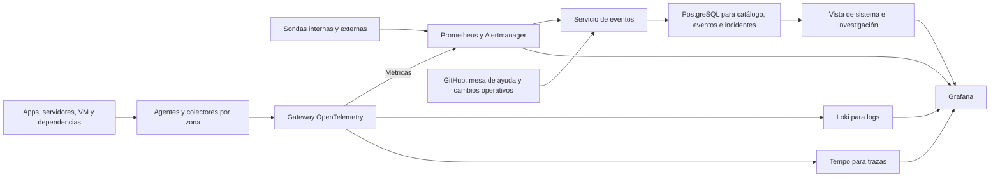

# Propuesta de plataforma de observabilidad y diagnóstico para los sistemas del MES

**22 de noviembre de 2026**

Propongo una plataforma autogestionada que organice el monitoreo alrededor de cada **sistema en un entorno**. En una incidencia, el operador debe poder pasar de «SGU devuelve errores al iniciar sesión» a «el fallo empieza en este tramo, afecta a estas operaciones y coincide con este cambio aplicado», abriendo las gráficas, logs, trazas, despliegues y tickets que sostienen el diagnóstico.

La primera entrega sería un piloto con **SGU en preproducción**, con HAProxy, Keycloak, PostgreSQL y sus VM como dependencias observadas. El catálogo de aplicaciones, la línea de tiempo de cambios y el expediente de investigación serían los componentes propios. La captura, almacenamiento, consulta y alertado usarían herramientas existentes.

## Qué tomar de LogicMonitor

| Capacidad documentada | Aplicación propuesta |
| --- | --- |
| Collectors Linux/Windows cerca de los recursos. Sondeo remoto mediante protocolos estándar, con colocación por red, dimensionamiento por carga y opciones de redundancia. | Colectores de zona para redes segregadas y agentes locales donde hagan falta logs o contexto del proceso. Supervisar la propia recolección desde el primer día. [Collector](https://www.logicmonitor.com/support/collectors/collector-overview/about-the-logicmonitor-collector) |
| LogicModules para descubrir, clasificar, medir, recoger logs, detectar cambios, mapear recursos y diagnosticar. El material local resalta el ciclo de vida de las plantillas y la asignación por propiedades mediante `AppliesTo`. | Recetas versionadas por tecnología y etiquetas del catálogo, con configuración comprobable, propietario y prueba de incorporación. [Tipos de módulos](https://www.logicmonitor.com/support/types-of-modules) |
| Service Insights agrega recursos e instancias y puede asociarlos con pruebas de experiencia. LM APM usa OpenTelemetry para explorar solicitudes entre servicios y abrir señales relacionadas. LM Logs asocia registros con recursos. | Ficha por sistema y entorno con salud desde la perspectiva del usuario, dependencias, instancias, registros y trazas. [Servicios](https://www.logicmonitor.com/support/service-addition), [LM APM](https://www.logicmonitor.com/support/lm-apm), [LM Logs](https://www.logicmonitor.com/support/lm-logs/lm-logs-overview) |
| ConfigSources registra cambios de configuración. DiagnosticSources recoge evidencia en el momento del fallo. | Registrar por separado configuración prevista, aplicada y observada. Ejecutar comprobaciones acotadas y de solo lectura, como salud de una dependencia o utilización del pool. [ConfigSources](https://www.logicmonitor.com/support/configsource-configuration), [DiagnosticSources](https://www.logicmonitor.com/support/diagnosticsources-configuration) |
| LogicMonitor usa topología y umbrales dinámicos para reducir ruido. Su mecanismo clásico Dependent Alert Mapping se apoya en alertas de alcanzabilidad. Edwin AI añade correlación, investigación, impacto, línea de tiempo e hipótesis con las fuentes conectadas. | Agrupar síntomas del mismo incidente utilizando el recorrido de la solicitud, la topología vigente y los cambios verificados. Mostrar evidencias y alertas originales, con hipótesis revisables. [Dependent Alert Mapping](https://www.logicmonitor.com/support/dependent-alert-mapping), [Umbrales dinámicos](https://www.logicmonitor.com/support/alerts/aiops-features-for-alerting/dynamic-thresholds-for-datapoints), [Edwin AI Investigation](https://www.logicmonitor.com/support/edwin-ai-investigation) |
| Pruebas sintéticas, monitoreo cloud, paneles reutilizables, informes, ventanas de mantenimiento e integraciones/API. | Medir operaciones críticas desde dentro y fuera de la red y reutilizar plantillas de incorporación y paneles por equipo. Extender a servicios cloud con métricas y eventos de sus API cuando existan. Aplicar las ventanas de mantenimiento al enrutamiento de alertas y conservar las señales para la investigación. [Pruebas externas](https://www.logicmonitor.com/support/external-web-checks-using-lm-uptime), [LM Cloud](https://www.logicmonitor.com/support/lm-cloud/getting-started-lm-cloud/lm-cloud-monitoring-overview), [API e integraciones](https://www.logicmonitor.com/support/logicmonitor-integrations-overview) |

La prioridad para el MES es documentar la **cadena de evidencia entre código y ejecución**, desde el PR y commit → pipeline y artefacto → despliegue declarado → versión y configuración observadas por instancia → solicitud afectada → intervención → recuperación. El vínculo con la mesa de ayuda aporta el síntoma que vio el usuario, su alcance y la validación del equipo. Un commit fusionado o un pipeline exitoso son eventos distintos de un despliegue verificado.

## Fuentes y datos que incorporar

| Fuente | Señales para investigar |
| --- | --- |
| **Aplicaciones y frontend** | Logs estructurados, excepciones, trazas HTTP/SQL/colas, errores de navegador cuando proceda, métricas de tráfico, errores y latencia por ruta normalizada. Eventos de negocio mínimos, por ejemplo si el inicio de sesión terminó correctamente. Para aplicaciones legadas, empezar con logs, proxy y sintéticos, dejando visible la cobertura de trazas. |
| **Servidores y ejecución** | Linux `journald`/`systemd`, Windows Event Log, CPU, memoria, disco, I/O, red, procesos, reinicios, OOM, estado de VM e hipervisor. Añadir eventos de contenedor, Docker o Kubernetes según lo que exista. Vincular cada observación con la instancia y el host vigentes. |
| **Entrada, red y TLS** | HAProxy/Nginx/IIS, distribución de 4xx/5xx, backend elegido, tiempos de conexión y respuesta, DNS interno/externo, expiración y cadena TLS, pérdida de conectividad. Capturar cambios aplicados en reglas, rutas, DNS y certificados como eventos. |
| **Dependencias y trabajos** | PostgreSQL y otros motores presentes, Keycloak/OIDC, LDAP, cachés, colas, correo, APIs, cron, backups y dependencias externas. Priorizar saturación de conexiones, bloqueos, latencia, retraso de colas, última ejecución válida y disponibilidad desde el punto de vista del consumidor. |
| **GitHub y CI/CD** | Eventos de PR, releases, `workflow_run`, `workflow_job`, `deployment` y `deployment_status` de repositorios seleccionados. Guardar metadatos, conclusiones, pasos fallidos y enlaces. Incorporar fragmentos de logs de Actions solo cuando aporten evidencia y estén saneados. Añadir auditoría de organización/empresa o alertas de dependencias si la edición, los permisos y el caso de uso lo permiten. [Eventos](https://docs.github.com/en/webhooks/webhook-events-and-payloads), [Logs de jobs](https://docs.github.com/en/rest/actions/workflow-jobs), [Auditoría Enterprise](https://docs.github.com/en/enterprise-cloud@latest/rest/enterprise-admin/audit-log) |
| **Despliegues y operación** | El pipeline o la herramienta de despliegue emite entorno, componente, SHA, artefacto/digest, migración y ventana. El sistema desplegado aporta versión/digest observados, instancia, estado y hora. Operaciones registra cambios manuales, parches, intervenciones y rollbacks con una referencia. Para configuración sensible, registrar hash y campos permitidos o enlazar al repositorio autorizado. |
| **Mesa de ayuda «freeservice»** | Recibir ID, sistema y entorno si se conocen, canal, categoría, estado, prioridad, horas y enlace al ticket o cambio. Usar el volumen y distribución de reportes para estimar impacto. Incorporar una nota saneada o un código de síntoma cuando sea necesario, y conservar conversaciones y adjuntos en la mesa. Si el nombre corresponde a **Freshservice**, usar su API v2 para tickets y cambios según alcance. Si corresponde a **FreeScout**, verificar el módulo API & Webhooks. Si es un servicio interno, implementar el mismo contrato sobre su API, webhook o exportación autorizada. [API Freshservice](https://api.freshservice.com/v2/), [Módulo FreeScout](https://freescout.net/module/api-webhooks/) |
| **Sondas y herramientas existentes** | Pruebas HTTP, DNS, TLS y de una transacción de negocio con datos de prueba. Incorporar estados de Checkmk si se confirma que cubre recursos del piloto. Los monitores de proveedores, plataformas cloud o herramientas adicionales se añaden mediante el mismo catálogo y contrato de eventos. [Checkmk REST API](https://docs.checkmk.com/latest/en/rest_api.html), [Blackbox Exporter](https://github.com/prometheus/blackbox_exporter) |

Empezar con fuentes que respondan preguntas del piloto. Cada conector debe declarar propietario, campos, permisos, política de retención, tasa esperada y qué ocurre si deja de entregar datos. Cuando una aplicación no exporte trazas, la investigación puede avanzar con correlación por identificador de petición, instancia, ruta y tiempo, y reflejar el tramo pendiente de instrumentar.

## Arquitectura propuesta

- **Captura.** OpenTelemetry en aplicaciones y colectores por zona. Exporters para infraestructura y dependencias cuando aporten señales. Sondeos desde redes autorizadas y desde un punto externo independiente para rutas públicas. La instrumentación del SGU se valida contra su runtime y dependencias reales en preproducción. [Patrón agente y gateway](https://opentelemetry.io/docs/collector/deploy/other/agent-to-gateway/), [Instrumentación PHP](https://opentelemetry.io/docs/languages/php/libraries/)
- **Almacenamiento y consulta.** Prometheus para métricas y Alertmanager para agrupación, enrutamiento e inhibiciones acotadas. Loki para logs, Tempo para trazas y Grafana para explorar las tres señales. Usar almacenamiento compatible con objetos para Loki/Tempo en producción. En Grafana se habilitan enlaces de una traza a los logs correspondientes. [Alertmanager](https://prometheus.io/docs/alerting/latest/alertmanager/), [Loki con OTLP](https://grafana.com/docs/loki/latest/send-data/otel/), [Correlación entre trazas y logs](https://grafana.com/docs/grafana/latest/datasources/tempo/configure-tempo-data-source/configure-trace-to-logs/)
- **Capa propia.** Una API y una vista operativa sobre PostgreSQL. Mantienen el catálogo de sistemas y relaciones, eventos normalizados, incidentes e hipótesis con referencias a las consultas y enlaces originales. Las relaciones se pueden guardar en tablas con vigencia y origen. Un recorrido acotado basta para el piloto. Las consultas pesadas siguen en los almacenes de telemetría.
- **Identidad y acceso.** Integrar SSO con Keycloak donde esté disponible. Definir permisos de consulta por equipo y entorno, también en la capa de datos. En Grafana, los permisos de carpetas por sí solos no aíslan las consultas de una fuente compartida. Para datos con distinto nivel de acceso, aplicar aislamiento en el backend o usar fuentes/organizaciones separadas según edición. Contemplar una vía operativa de emergencia cuando falle el proveedor de identidad. [Keycloak en Grafana](https://grafana.com/docs/grafana/latest/setup-grafana/configure-access/configure-authentication/keycloak/), [Acceso a fuentes de datos](https://grafana.com/docs/grafana/latest/administration/data-source-management/)
- **Continuidad.** Cifrado en tránsito, colas persistentes donde aplique, almacenamiento acotado y reintentos para tolerar cortes de enlace. Medir retraso, errores de exportación, disco, colas y antigüedad de la última señal. Un monitor independiente comprueba que la plataforma pueda alertar aunque uno de sus colectores o backends falle. [Resiliencia de OpenTelemetry Collector](https://opentelemetry.io/docs/collector/resiliency/)

La **ficha de sistema** muestra disponibilidad y latencia por operación, dependencias, versión por instancia y cobertura de señales. La **vista de incidente** abre una línea de tiempo con alertas, tickets, cambios y consultas filtradas al periodo afectado. Una **vista de recolección** identifica conectores retrasados y distingue una dependencia caída de una fuente sin datos.

### Identidad común y confiabilidad de los eventos

Cada aplicación tiene un `system_id` estable. Cada señal añade, según corresponda, `service.name`, `deployment.environment.name`, `service.version`, el identificador de instancia y el de host. Las solicitudes se enlazan con `trace_id` y `span_id` o un `request_id` de confianza. Los cambios se enlazan con `commit_sha`, digest, `deployment_id` y el alcance efectivo. Las relaciones `depende de`, `corre en` y `publicado por` registran origen, vigencia y última observación. Una dependencia inferida por trazas puede coexistir con una declarada en el catálogo. [Convenciones OpenTelemetry](https://opentelemetry.io/docs/specs/semconv/registry/attributes/service/), [Propagación de contexto](https://opentelemetry.io/docs/languages/php/propagation/)

Los eventos llevan origen, tipo, ID de origen, instante de ocurrencia e instante de recepción en UTC. Para GitHub, usar una GitHub App con alcance mínimo, validar firma y guardar la entrega en una cola o bandeja persistente antes de confirmarla. Deduplicar por ID y conciliar eventos atrasados o perdidos por API, con reintentos, cursor y control de límites. Si la red impide aceptar webhooks públicos, comenzar con consulta saliente. Exponer en el incidente el retraso o silencio de una fuente. [Buenas prácticas de webhooks de GitHub](https://docs.github.com/en/webhooks/using-webhooks/best-practices-for-using-webhooks)

Aplicar una lista de campos permitidos antes del almacenamiento, con supresión de credenciales, cookies, tokens, datos personales y cuerpos de solicitudes. Guardar los identificadores de alta cardinalidad como campos de búsqueda y reservar las etiquetas de métricas y logs para dimensiones acotadas. Durante el piloto, conservar todas las trazas del flujo de prueba si el volumen lo permite. Al escalar, preservar preferentemente errores, rutas lentas y sondas críticas, y medir la pérdida de cobertura del muestreo. Los indicadores de disponibilidad deben venir de métricas o sondas independientes del muestreo. [Metadatos estructurados de Loki](https://grafana.com/docs/loki/latest/get-started/labels/structured-metadata/), [Muestreo de OpenTelemetry](https://opentelemetry.io/docs/concepts/sampling/)

## Cómo se investiga un incidente

1. **Detectar el efecto.** Una sonda falla, una métrica incumple el objetivo o la mesa recibe reportes. Se abre un expediente con sistema, entorno, operación afectada, hora estimada de inicio, cobertura y responsable.
2. **Localizar el primer fallo observable.** Comparar puntos de observación, trazas, logs, métricas y grafo vigente. Buscar qué dependencia falló antes y qué recursos siguen sanos. Deduplicar por fuente y agrupar por entorno, síntoma y dependencia. Una alerta sin relación firme se conserva como incidente independiente o como candidata al grupo.
3. **Ordenar hipótesis.** Priorizar evidencia directa, precedencia temporal, relación con la ruta afectada, alcance por versión/instancia y contraste con controles sanos. La proximidad de un despliegue vale como indicio. Para sostener una causa se necesita un mecanismo observable y una comprobación adicional, como reproducción controlada, comparación de cohortes o recuperación reproducible después de corregir.
4. **Presentar evidencia y alternativas.** Cada hipótesis indica origen y hora de los datos, enlaces, observación que la respalda, observación que la debilita y comprobación siguiente. Las hipótesis se muestran como **confirmadas**, **probables** o **indeterminadas**. El operador puede registrar factores contribuyentes y confirmar o corregir el diagnóstico.
5. **Verificar la recuperación.** Registrar la acción realizada y comparar el indicador afectado, la transacción sintética y los reportes tras la intervención. Con autorización de escritura, vincular o actualizar un único ticket mediante una clave de incidente. Si la API no ofrece idempotencia nativa, reconciliar respuestas ambiguas antes de reintentar.

**Ejemplo de diagnóstico.** En el piloto, una operación de SGU empieza a devolver 5xx. La sonda llega a HAProxy y el proxy alcanza a SGU. Las trazas muestran que la espera está en la adquisición de una conexión a PostgreSQL. La métrica del pool registra saturación y los logs identifican el mismo fallo. El historial sitúa el inicio tras el despliegue de un nuevo digest, y solo las instancias con ese digest fallan con carga comparable. En preproducción se reproduce la diferencia con ambas versiones. La revisión del cambio muestra que la nueva ruta dejó de devolver conexiones al pool en un caso de error. La corrección recupera las conexiones y elimina los 5xx bajo la misma prueba. La conclusión separa el **mecanismo observado** —agotamiento del pool—, el **cambio que lo introdujo** y su **impacto en usuarios**. Con evidencia parcial, la aplicación presenta la hipótesis como probable o indeterminada.

La primera versión usa reglas y consultas reproducibles. Un asistente de IA posterior puede resumir el expediente y recuperar incidentes similares o runbooks autorizados. Sus respuestas deben enlazar evidencia concreta, señalar información faltante y someter la conclusión a revisión del operador. Los datos de logs y tickets se tratan como contenido de entrada, y los conectores del asistente quedan limitados a consultas autorizadas.

## Piloto y criterios de aceptación

| Fase | Entrega y comprobación |
| --- | --- |
| **Semana 1 · Inventario y recorrido** | Registrar SGU, repositorios, responsables, entornos, hosts y dependencias. Verificar identidad del producto «freeservice», permisos de GitHub y topología vigente. Definir dos comprobaciones, por ejemplo salud del servicio e inicio de sesión con identidad de prueba. Medir disponibilidad, latencia y tiempo actual de investigación. Para la fase siguiente, acordar objetivos de servicio por operación y alertar cuando las tasas de error o lentitud indiquen que se están incumpliendo. |
| **Semanas 2 y 3 · Telemetría** | Montar el piloto en preproducción. Completar métricas del host, logs de aplicación/proxy, trazas del recorrido disponible, PostgreSQL, sondas y visibilidad del colector. Verificar que una misma solicitud sea navegable entre las señales disponibles. |
| **Semanas 4 y 5 · Cambios e incidentes** | Integrar GitHub, confirmación de versión desplegada y mesa de ayuda en lectura. Entregar ficha de sistema, línea de tiempo, deduplicación y reglas diagnósticas para proxy/backend, identidad y saturación de BD. Probar el vínculo con tickets en un entorno autorizado. |
| **Semana 6 y margen de 2 semanas · Validación** | Ejecutar pruebas controladas, medir qué casos se diagnostican y cuánto tardan. Probar pérdida de telemetría, recuperación de ingesta y aislamiento de permisos. Dimensionar la operación antes de incorporar producción y nuevos sistemas. |

Las cifras siguientes son objetivos iniciales del piloto, sujetos a la línea base de la primera semana.

- Detectar una caída simulada en **menos de 2 minutos** y mostrar la primera hipótesis verificable en **menos de 10 minutos** desde la alerta, en al menos 4 de 5 ejercicios acordados.
- Los cinco ejercicios cubren fallo de backend tras HAProxy, error de identidad/DNS/TLS, saturación de PostgreSQL, regresión por despliegue y pérdida de telemetría. Incluir una ejecución con evidencia insuficiente y comprobar que queda **indeterminada**.
- Vincular el **100 %** de los despliegues del piloto con el artefacto observado. En al menos el **95 %** de las solicitudes sintéticas instrumentadas que fallen, poder abrir la traza y los logs correlacionados del tramo instrumentado.
- En pruebas de repetición de webhooks, producir un solo evento lógico por ID y una sola referencia de ticket por incidente. Registrar métricas de cobertura, falsos agrupamientos y tiempo de detección/diagnóstico.

### Capacidad, mantenimiento y coste

Para dimensionar, medir durante siete días GB de logs por día, spans por segundo, tamaño medio de span, series activas, muestras por segundo, cardinalidad, consultas simultáneas y pico de eventos. Como política inicial del piloto, proponer 14 días de logs, 7 de trazas, 30 de métricas y 90 de metadatos de cambios e incidentes, sujetos al uso real y a la política institucional. Estimar por señal a partir de la tasa medida y los días de retención. Por ejemplo, 5 GB diarios de logs durante 14 días equivalen a 70 GB de datos brutos antes de estimar compresión, índices, réplicas, copias y margen de crecimiento. Definir procedimientos de restauración de catálogo/eventos y de actualización de los componentes. El equipo de plataforma opera la recolección y el almacenamiento, cada dueño de sistema mantiene su instrumentación y Operaciones valida alertas, runbooks y guardias.

| Ruta | Cuándo encaja |
| --- | --- |
| **Autogestionar OpenTelemetry y Grafana con una capa propia** | Recomendada para el piloto por el control sobre conectividad, retención, integración con las aplicaciones y trazabilidad. El presupuesto incluye VM, almacenamiento, copias, guardia, actualizaciones y construcción de conectores. |
| **Probar un backend más integrado, como SigNoz autogestionado** | Considerarlo si el equipo necesita operar menos piezas visibles. Comparar permisos, retención, escalado y facilidad de enlazar consultas desde el expediente. El catálogo, el historial de cambios y la integración con tickets siguen siendo entregables propios. [SigNoz autogestionado](https://signoz.io/docs/ingestion/self-hosted/overview/) |
| **Comprar LogicMonitor y añadir contexto MES** | Considerarlo si ya existe contrato o la cobertura de infraestructura y el soporte justifican la compra. Validar salida a la nube, residencia, ingestión, límites y módulos de la cuenta. Pedir una cotización basada en el inventario y el volumen medido. [Precios LogicMonitor](https://www.logicmonitor.com/pricing), [Notas de versión](https://www.logicmonitor.com/release-notes/platform-release-notes-timeline) |

La decisión al terminar el piloto debe basarse en cuánto tarda un operador en encontrar la causa, cuántos incidentes quedan indeterminados por falta de datos y cuánto cuesta operar cada fuente. **La primera entrega útil es el expediente de un incidente de SGU con una hipótesis comprobable y enlaces que permitan revisarla.**

## Material de referencia

- La guía, el mapa de estudio y el índice de cursos del equipo organizan los materiales de Envision, recursos, arquitectura y operación.
- Los cursos de Collectors, LogicModules, LM Logs y Edwin AI sustentan los patrones de continuidad, topología, investigación y gestión de cambios. Las simulaciones de Service Insights y los cursos de recursos, alertas, dashboards e informes aportan patrones de incorporación y operación.
- El mapa de dependencias, los expedientes de SGU e Interoperabilidad y el inventario de servicios documentan el recorrido candidato y sus responsables. La topología y cobertura vigentes se comprobarían al iniciar el piloto.
