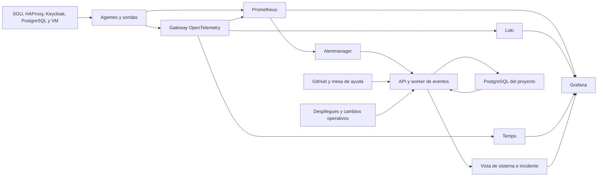

# Proyecto técnico de observabilidad y diagnóstico de sistemas del MES

**Versión 1.0 · 22 de noviembre de 2026 · Diseño para revisión técnica**

## Resumen y solicitud de infraestructura

El proyecto permite detectar un problema en un sistema del MES y documentar su causa con evidencia de la aplicación, sus servidores, dependencias, cambios de código, despliegues y reportes de usuarios. La primera entrega cubrirá **SGU en preproducción**, su entrada por HAProxy, Keycloak y PostgreSQL. Desde un incidente se podrá abrir la traza, ver los logs y las métricas del intervalo, identificar la versión que estaba ejecutándose y seguir el ticket asociado.

| Recurso | Solicitud inicial |
| --- | --- |
| VM principal del piloto | **8 vCPU x86-64, 32 GiB de RAM y 450 GiB SSD**. Disco de sistema de 50 GiB y disco de datos de 400 GiB, ampliable. Interfaz virtual de 1 Gbit/s. |
| Sistema operativo y ejecución | Ubuntu Server 24.04 LTS o imagen Linux institucional equivalente. Docker Engine y Compose v2. Imágenes fijadas por versión y digest al preparar el despliegue. [Ubuntu 24.04 LTS](https://documentation.ubuntu.com/release-notes/24.04/), [Docker Compose en producción](https://docs.docker.com/compose/how-tos/production/) |
| Red y acceso | IP privada estable, nombre DNS interno, certificado TLS y acceso administrativo por el canal institucional. Conectividad autorizada con los sistemas del piloto, Keycloak, GitHub y la mesa de ayuda. |
| Respaldo externo | **100 GiB iniciales fuera de la VM** para copias de PostgreSQL, configuración y dashboards. Ajustar la cuota según el tamaño restaurado y la política de rotación. |
| Sonda o vigilancia independiente | Reutilizar un monitor institucional en otro host si está disponible. Si hace falta desplegar una sonda ligera, reservar **1 vCPU, 1–2 GiB de RAM y 10 GiB de disco** fuera del dominio de fallo de la VM principal. |
| Producción inicial | Punto de partida sujeto al piloto: **16 vCPU, 64 GiB de RAM, 660 GiB SSD local** y **1 TiB de almacenamiento de objetos externo** para logs y trazas. Copias y vigilancia independiente se dimensionan aparte. |

Los tamaños son estimaciones de ingeniería para la carga indicada más adelante. Una VM central permite desplegar y validar el piloto. Si se requiere que la plataforma siga consultando y alertando durante la pérdida de esa VM, el diseño debe distribuir la ingesta, el alertado y los datos entre dominios de fallo.

[Propuesta de observabilidad para el MES](PROPUESTA-OBSERVABILIDAD-MES.md)

## Alcance funcional

- **Ficha de sistema.** Muestra propietario, entorno, endpoints, dependencias, instancias, versión observada y salud desde el punto de vista del usuario. Informa de fuentes sin datos o retrasadas.
- **Exploración de telemetría.** Filtra logs, métricas y trazas por sistema, entorno, operación e intervalo. Permite abrir el registro asociado a una traza o una vista de infraestructura en el mismo periodo.
- **Línea de tiempo.** Integra cambios de GitHub, ejecuciones de CI/CD, despliegues, configuración aplicada, intervenciones, alertas y referencias de la mesa de ayuda.
- **Investigación.** Agrupa alertas relacionadas, muestra el alcance, ordena hipótesis y enlaza las comprobaciones. Operaciones registra el mecanismo del fallo, el cambio o condición que lo originó y la evidencia de recuperación.
- **Alta de sistemas.** Plantilla versionada con propietario, entorno, dependencias, esquema de telemetría, sondas, alertas y enlaces a runbooks. Después de SGU se aplica a otros sistemas por etapas, con prioridad por criticidad y facilidad de instrumentación.

## Arquitectura y componentes

| Componente | Responsabilidad y despliegue |
| --- | --- |
| Gateway OpenTelemetry Collector | Ingesta OTLP, enriquecimiento, filtros de datos, procesamiento por lotes y exportación. Agentes en los hosts que requieren acceso a archivos o registros locales. Colectores o sondas por zona cuando la segmentación impida una captura central. Colas persistentes en exportadores que lo admitan. [Patrón agente y gateway](https://opentelemetry.io/docs/collector/deploy/other/agent-to-gateway/), [Resiliencia](https://opentelemetry.io/docs/collector/resiliency/) |
| Prometheus y Alertmanager | Prometheus recoge métricas de sondas, exporters y, donde corresponda, del Collector. Alertmanager enruta y deduplica notificaciones. Una fuente tiene una ruta de captura definida para evitar muestras duplicadas. [Prometheus](https://prometheus.io/docs/prometheus/latest/storage/), [Alertmanager](https://prometheus.io/docs/alerting/latest/alertmanager/) |
| Loki y Tempo | Loki para logs por metadatos y Tempo para trazas por ID. En el piloto se ejecutan en modo monolítico con volúmenes locales persistentes. En producción, usar almacenamiento de objetos para los bloques y conservar en SSD los registros de escritura, cachés y áreas temporales. Validar la versión y el modo antes de adoptar su configuración. [Loki](https://grafana.com/docs/loki/latest/get-started/deployment-modes/), [Tempo](https://grafana.com/docs/tempo/latest/set-up-for-tracing/setup-tempo/deploy/locally/linux/) |
| Grafana | Paneles, consulta de métricas/logs/trazas y enlaces entre señales. Provisionar fuentes y paneles desde archivos versionados. Integrar Keycloak y verificar el acceso a la fuente de datos para cada equipo y entorno. [Keycloak en Grafana](https://grafana.com/docs/grafana/latest/setup-grafana/configure-access/configure-authentication/keycloak/), [Permisos de fuentes](https://grafana.com/docs/grafana/latest/administration/data-source-management/) |
| API, interfaz y worker propios | Base propuesta en Python con FastAPI, interfaz web renderizada en servidor y un worker del mismo proyecto como proceso separado. El worker importa eventos, reconcilia entregas, ejecuta reglas de correlación y actualiza incidentes. La API sirve catálogo, evidencias y línea de tiempo. Usar PostgreSQL como bandeja persistente durante el piloto. [Despliegue FastAPI](https://fastapi.tiangolo.com/deployment/concepts/) |
| PostgreSQL del proyecto | Base dedicada al catálogo, historial de dependencias, eventos, incidentes y auditoría. Separada de la base de datos de SGU. Aplicar migraciones versionadas y roles distintos para la aplicación, respaldo y administración. |
| Proxy HTTPS | Único punto de entrada de la UI y la API interna. Finaliza TLS, aplica autenticación o validación de clientes según la ruta y mantiene privados los backends. La sonda independiente comprueba la disponibilidad del servicio y la llegada de señales. |

### Integraciones y datos

| Fuente | Qué hace falta y cómo se valida |
| --- | --- |
| **SGU y sus servidores** | Acceso al código y al pipeline de preproducción, dueño técnico, identidad de prueba, permiso para instrumentar el runtime y lectura delegada de logs. Propagar el contexto de traza en HTTP y agregar el identificador de traza o petición al log. Registrar versión/digest por instancia. |
| **HAProxy, Keycloak y PostgreSQL** | Métricas y logs autorizados del proxy y del proveedor de identidad. Cuenta de métricas de solo lectura para PostgreSQL, con permiso limitado a las vistas requeridas. Sondas de DNS/TLS y del flujo OIDC con datos de prueba. Asociar cada activo a la ruta de SGU que usa ese componente. |
| **GitHub** | GitHub App con permiso de lectura en los repositorios del piloto y aprobación de sus propietarios. Importar PR, SHA, ejecuciones, resultado de jobs y estados de despliegue relevantes. En primera instancia se puede consultar la API por salida HTTPS. Si se habilitan webhooks, validar firma, persistir la entrega antes de responder y reconciliar por API. Mantener enlaces a Actions y guardar solo extractos de logs autorizados. [Workflow runs](https://docs.github.com/en/rest/actions/workflow-runs), [Estados de despliegue](https://docs.github.com/en/rest/deployments/statuses), [Webhooks](https://docs.github.com/en/webhooks/using-webhooks/best-practices-for-using-webhooks) |
| **Despliegues** | Acuerdo con el dueño de cada pipeline. Registrar el artefacto promovido y comprobar su SHA o digest desde el runtime en cada instancia. Registrar también rollback, cambio manual y migración aplicada. El evento de CI y la observación de runtime son dos registros vinculados. |
| **Mesa de ayuda «freeservice»** | Confirmar producto, URL, propietario, API y credenciales de lectura. Capturar ID, estado, horas, categoría, sistema, alcance y enlace. Habilitar la actualización de tickets después de probar permisos, deduplicación y reconciliación en una instancia de prueba. [Freshservice API](https://api.freshservice.com/v2/), [FreeScout API y webhooks](https://freescout.net/module/api-webhooks/) |
| **Monitoreo existente** | Si Checkmk cubre los recursos necesarios, importar el estado permitido de hosts y servicios y enlazar su vista de origen. Acordar qué herramienta alerta por cada condición. [Checkmk REST API](https://docs.checkmk.com/latest/en/rest_api.html) |

### Contrato de datos y diagnóstico

El catálogo vincula `system_id`, entorno, servicio, instancia, host y repositorio mediante relaciones con origen y vigencia. El evento normalizado contiene origen, ID de origen, tipo, hora del evento y de recepción en UTC, sistema, entorno, severidad, versión cuando aplique y enlace a la evidencia. La clave única `(source, scope, source_event_id)` evita duplicados al repetir una entrega. Las consultas diferencian la hora del cambio de la hora en que el conector se enteró. Identificadores de petición, usuario y trazas quedan fuera de las etiquetas de series.

La primera versión utiliza reglas explicables. Un 503 del proxy se compara con el estado de sus backends y sondas desde su red. Un fallo de autenticación se contrasta con DNS, TLS y el recorrido OIDC. Una degradación de datos se contrasta con spans de BD, utilización del pool, esperas y cambios recientes. Cada hipótesis guarda los datos que la sostienen, la evidencia que la debilita y la comprobación recomendada. La confirmación requiere evidencia del mecanismo y validación de un responsable. Se mantienen los estados **probable**, **confirmada** e **indeterminada**. [Convenciones OpenTelemetry](https://opentelemetry.io/docs/specs/semconv/registry/attributes/service/)

## Red, cuentas y requisitos previos

| Flujo | Acceso requerido |
| --- | --- |
| Operadores → proxy de observabilidad | TCP 443 desde redes autorizadas. Nombres internos sugeridos `obs.<dominio-interno>` y, si se usa un virtual host aparte para Grafana, `grafana-obs.<dominio-interno>`. |
| Agentes/colectores → gateway | OTLP/HTTP por 443 en una ruta o nombre de ingesta dedicado con autenticación de cliente. Si se usa OTLP/gRPC directo, TCP 4317/TLS limitado a orígenes aprobados. El puerto por defecto 4318 de OTLP/HTTP puede quedar interno detrás del proxy. [Especificación OTLP](https://opentelemetry.io/docs/specs/otlp/) |
| Prometheus o colector de zona → exporters | Solo puertos de métricas que se acuerden por activo. La conexión se origina en el recolector autorizado. Cuando una red esté aislada, usar un colector local con salida cifrada al gateway. |
| Sondas → SGU y dependencias | HTTPS y DNS hacia resolutores y rutas aprobadas. Acceso a endpoints privados de salud y métricas solo desde el punto de prueba acordado. |
| Conectores → GitHub, mesa de ayuda, Keycloak y repositorio de imágenes | HTTPS saliente por destino. Si se aprueba la recepción de webhooks, publicar solo el endpoint de recepción en un punto de entrada autorizado. |
| Servicios internos → PostgreSQL/Loki/Tempo/Prometheus | Puertos en red privada de contenedores o en segmentos autorizados al separar componentes. Proteger Loki con un proxy de autenticación si requiere acceso fuera de esa red. [Autenticación de Loki](https://grafana.com/docs/loki/latest/operations/authentication/) |
| Administración y servicios base | Acceso SSH por bastión, DNS/NTP institucionales, certificados confiables y destino externo de copias. Acordar acceso al almacenamiento de objetos antes de promover a producción. |

Antes del despliegue se requiere una VM asignada, inventario inicial de SGU con responsables, acceso al repositorio de configuración y al registro de imágenes, cuentas de servicio, certificado, destino de copias y un entorno de preproducción con datos adecuados para los ejercicios. El equipo de redes valida las rutas. Los propietarios de datos aprueban los campos que salen de cada sistema.

La ingesta aplica listas de campos permitidos y elimina credenciales, cookies, tokens y contenido sensible antes del almacenamiento. La UI conserva el enlace a la fuente original bajo sus propios permisos. Se auditan cambios de catálogo, conectores y acciones sobre incidentes. Las credenciales de integraciones se guardan en el mecanismo institucional de secretos. Administradores y operadores tienen permisos diferenciados. Operaciones conserva una vía de acceso de emergencia auditada para una caída de Keycloak.

## Dimensionamiento de la VM

### Envolvente del piloto

| Variable | Supuesto de planificación |
| --- | --- |
| Alcance | 1 sistema, hasta 10 VM o instancias entre aplicación, proxy, identidad, BD y sondas. |
| Logs | Hasta 5 GB por día de registros crudos aceptados. Retención de 14 días. |
| Trazas | Hasta 50 spans/s de promedio después del filtrado, 1 KiB por span como hipótesis. Retención de 7 días. |
| Métricas | Hasta 5 000 muestras/s aceptadas con 30 días de retención. Medir también las series activas y su rotación. |
| Eventos | Hasta 10 000 por día de aproximadamente 2 KiB por evento. Retención operativa de 90 días. |
| Consultas | Hasta 5 operadores simultáneos en consultas típicas de diagnóstico. Validar con una ráfaga de ingestión de 2× durante una hora. |

Con estos supuestos, los logs suman **70 GB brutos** en 14 días, las trazas unos **29 GiB brutos** en 7 días, las muestras de Prometheus unos **12–24 GiB estimados** en 30 días y los eventos unos **1,7 GiB brutos** en 90 días. La ocupación efectiva depende de compresión, índices, cardinalidad, registros de escritura y consultas. Para Prometheus, la referencia de 1–2 bytes por muestra estima los bloques y se presupuestan aparte los picos de datos en escritura. Un SSD local o disco en bloque respaldado por SSD da margen a la escritura concurrente. [Dimensionamiento de Prometheus](https://prometheus.io/docs/prometheus/latest/storage/)

| Presupuesto del disco de datos | GiB |
| --- | ---: |
| Loki, bloques, índices y escrituras temporales | 125 |
| Tempo, bloques, caché y WAL | 80 |
| Prometheus, bloques, WAL y datos recientes | 55 |
| PostgreSQL del proyecto y espacios temporales | 35 |
| Colas de colectores, estado, diagnósticos y buffers | 30 |
| Espacio libre para picos, compactación y crecimiento inicial | 75 |
| **Total** | **400** |

Montar los datos bajo `/srv/observabilidad` con volúmenes persistentes. Aplicar límites de retención y vigilar el uso por componente. Limitar Prometheus por tamaño y tiempo, reservando espacio para escrituras recientes. Aislar o acotar el espacio de las colas para que una caída del destino no agote todos los volúmenes. Configurar rotación para logs del sistema y contenedores en el disco de sistema.

Como reparto inicial de RAM para medir, reservar **4 GiB para el sistema**, **3 GiB para el gateway**, **5 GiB para Prometheus y Alertmanager**, **5 GiB para Loki**, **5 GiB para Tempo**, **3 GiB para PostgreSQL**, **3 GiB para Grafana, API, worker y proxy** y **4 GiB de margen**. Ajustar límites de contenedor y paralelismo tras la prueba de carga. La RAM de agentes en otros hosts se mide y presupuesta en cada entorno.

### Producción inicial y ampliación

La configuración de **16 vCPU, 64 GiB de RAM, 60 GiB de sistema y 600 GiB de datos locales** es una estimación para una primera ampliación a **15 GB/día de logs, 150 spans/s, 15 000 muestras/s y 10 operadores concurrentes**. Con retenciones de 30 días de logs y 14 de trazas, esos volúmenes representan unos 592 GiB brutos antes de compresión, índices y margen. La reserva inicial de **1 TiB externo** cubre bloques de Loki y Tempo y debe validarse con el servicio de objetos real. Para Prometheus se estima retención inicial de 60 días y almacenamiento local. Las cuotas de copias se calculan fuera de la capacidad primaria. [Modos y escala de Loki](https://grafana.com/docs/loki/latest/get-started/deployment-modes/), [Arquitectura de Tempo](https://grafana.com/docs/tempo/latest/reference-tempo-architecture/about-tempo-architecture/)

Durante siete días medir ingestión, series activas, memoria, CPU, espacio, latencia de consultas, retraso y descarte de datos. Investigar o ampliar cuando el crecimiento proyecte superar el 75 % del disco en 14 días, el uso de memoria o CPU supere el 75 % de forma sostenida durante las ventanas habituales, o aumenten retraso, rechazos o tiempo de consulta. Para alta disponibilidad, separar gateways y alertado, usar almacenamiento externo resiliente y definir replicación y recuperación de PostgreSQL. El diseño de alta disponibilidad se dimensiona con la carga y el objetivo de continuidad de producción.

## Despliegue, operación y entregables

| Etapa | Trabajo y salida verificable |
| --- | --- |
| 1. Semana 1 | Confirmar inventario, dependencias, responsables y producto «freeservice». Aprovisionar red y VM, acordar campos, comprobar accesos y medir línea base de diagnóstico. |
| 2. Semanas 2 y 3 | Versionar Compose, configuración, dashboards y alertas. Desplegar el stack y sondas. Instrumentar SGU y su ruta. Entregar una solicitud de prueba trazable de la sonda a los logs, métricas y spans disponibles. |
| 3. Semanas 4 y 5 | Entregar API, catálogo, worker, integración GitHub y lectura de mesa de ayuda. Registrar versión observada. Entregar vista de incidente con selección de evidencias, deduplicación y reglas diagnósticas. |
| 4. Semana 6 y hasta 2 de margen | Validar los cinco ejercicios, ejecutar carga y restauración, cerrar capacidad, accesos y runbooks. Documentar condiciones para promover a producción. |

Para ejecutar el piloto se estima **una persona de plataforma/operaciones y una de desarrollo**, con participación parcial de los propietarios de SGU, identidad, BD, red, seguridad y mesa de ayuda. El plazo depende de la disponibilidad de preproducción, accesos e instrumentación. Plataforma mantiene infraestructura y copias. Desarrollo mantiene integraciones y aplicación. Operaciones valida el diagnóstico y las alertas. Cada dueño de sistema mantiene su catálogo y telemetría.

El repositorio debe entregar manifiestos de despliegue, configuración saneada, migraciones, conectores, paneles, reglas, fichas de incorporación y runbooks de instalación, actualización, restauración e investigación. Antes de actualizar se conserva la versión de imágenes y configuración, se respalda la base de datos y se ensaya la restauración. Se devuelve la versión anterior junto con una migración o restauración compatible si la actualización modifica el esquema.

Hacer copias diarias verificadas del catálogo y la base de incidentes. Probar restauración en un entorno aislado con objetivo inicial para metadatos de **RPO de 24 horas y RTO de 4 horas** en el piloto. Para producción, si se aprueba **RPO de 1 hora**, combinar respaldo base con archivo de WAL y medirlo mediante restauración a un punto en el tiempo. La retención de logs y trazas y la recuperación tras pérdida de la VM se verifican por separado. [Recuperación a un punto en el tiempo en PostgreSQL](https://www.postgresql.org/docs/current/continuous-archiving.html)

## Criterios de aceptación del piloto

1. Cubrir cinco ejercicios coordinados en preproducción: fallo de backend, interrupción de identidad/DNS/TLS, saturación de PostgreSQL, regresión por despliegue y pérdida de telemetría.
2. Detectar el incidente o la pérdida de la señal en menos de **2 minutos** y presentar la primera hipótesis comprobable en menos de **10 minutos desde la alerta**, en al menos cuatro ejercicios. Un ejercicio con evidencia insuficiente debe quedar registrado como indeterminado.
3. Vincular todos los despliegues del piloto con el artefacto observado. Abrir traza y logs correlacionados en al menos el **95 %** de las solicitudes sintéticas fallidas del tramo instrumentado.
4. Verificar que una entrega repetida crea un solo evento lógico. Si se habilita escritura en la mesa de ayuda, comprobar que existe una referencia de ticket por incidente.
5. Validar la ráfaga de carga, el alertado independiente, los permisos por rol y la recuperación de metadatos. Registrar utilización, desfase de ingesta, descartes y espacio recuperable antes de aprobar el tamaño de producción.
